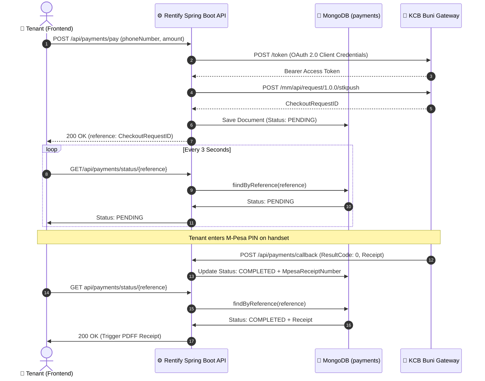

<div align="center">

# ⚙️ RENTIFY BACKEND
### Core Payment Gateway, Escrow & Scheduling Engine

*Powering instant KCB Buni M-Pesa STK Push, Visa card processing and real-time MongoDB transaction tracking for Kenyan real estate.*

<!--Technology Stack Badges -->
<p>


</p>

<!--System status Badges--> 
<p>


</p>

</div>

---

## 📌 Executive Summary

The **Rentify Backend** is  the financial and operational engine behind the Rentify Digital Real Estate Marketplace. Designed to handle high-trust property viewing scheduling across Nairobi, Mombasa, Malindi, and beyond, this RESTful Spring Boott service bridges the Rentify HTML/JS frontend with **KCB Buni banking rails** and **MongoDB**.

It automates the entire payment lifecycle:
1. **Search OAuth 2.0 Handshake:** Dynamically authenticates with KCB Buni using Base64-encoded client credentials.
2. **Instant STK Push & Card Processing:** Triggers mobile money prompts to tenants handsets and processes bank cards checkouts.
3. **Asynchronous Webhook Ingestion:** Listens for KCB Buni payment callbacks, validates statuses, and extracts official M-Pesa receipt numbers.
4. **Real-Time Status Polling:** Servers Low - latency transaction states ( 'PENDING' , 'COMPLETED' , 'FAILED' ) to the frontend receipt engine.

---

## 🏗️ System & Payment Sequence Architecture



---

##  💎 Core Backend Capabilities

<table>
<tr>
<td width="50%" valign="top">
<h3>KCB Buni M-Pesa Engine</h3>
<ul>
<li><strong>Automated Token Management:</strong> Encodes consumer keys and secrets on the fly for KCB UAT/Production OAuth endpoints.</li>
        <li><strong>Dynamic Invoice Generation:</strong> Generates unique invoice references and tracks KCB <code>CheckoutRequestID</code> mappings.</li>
        <li><strong>Resilient Callback Parser:</strong> Safely parses nested KCB JSON callback payloads to extract <code>MpesaReceiptNumber</code> metadata.</li>
      </ul>
</td>
<td width="50%" valign="top">
<h3>MongoDB & REST Infrastructure</h3>
<ul>
<li><strong>Document Persistence:</strong> Stores full audit trails in MongoDB with indexed unique transaction references.</li>
        <li><strong>Multi-Channel Checkout:</strong> Unified controller handling both Safaricom M-Pesa STK Push and Visa/Mastercard endpoints.</li>
        <li><strong>Frontend-Ready CORS & JSON:</strong> Clean JSON responses engineered for seamless integration with the Rentify Tailwind/JS frontend.</li>
      </ul>
</td>
</tr>
</tabble>

---

## Project Structure

```text
src/main/java/com/amoney/rentify_backend/
├── controller/
│   └── PaymentController.java      # REST endpoints (/pay, /card, /callback, /status)
├── dto/
│   └── PaymentRequest.java         # Request payload validation & mapping
├── model/
│   └── Payment.java                # MongoDB @Document schema for transactions
├── repository/
│   └── PaymentRepository.java      # Spring Data MongoDB query interface
├── service/
│   └── PaymentService.java         # KCB Buni OAuth 2.0 & STK Push integration
└── RentifyApplication.java         # Spring Boot application entry point
```

---

## Getting Started

## Prerequisites
**JDK 25** & **Maven 3.8+** |
**MongoDB** |
**KCB Buni Developer Account** |
**ngrok** 

## 1. Clone & Configure Environment

```bash
git clone https://github.com
cd rentify_backend

```

Configure 'src/main/resources/application.properties`:
```properties
# Server & Database
Server.port=8080
spring.data.mongodb.uri=mongodb://localhost:27017/rentify_db

# KCB Buni Sandbox Credentials
kcb.consumer.key=YOUR_KCB_CONSUMER_KEY
kcb.consumer.secret=YOUR_KCB_CONSUMER_SECRET
kcb.token.url=https://kcbgroup.com
kcb.stk.url=https://kcbgroup.com
kcb.callback.url=https://ngrok-free.app
```

## 2. Start   Webhook Tunnel & Server
```bash
# Terminal 1: Exponse local port 8080 for KCB callbacks 
ngrok http 8080

# Terminal 2. Run the Spring Boot backend
./mvnw spring-boot:run
```

---

## API Reference
| Method | Endpoint | Description | Payload / Params |
| :--- | :--- | :--- | :--- |
| `POST` | `/api/payments/pay` | Initiates KCB Buni M-Pesa STK Push | `{"phoneNumber": "2547...", "amount": "4500"}` |
| `POST` | `/api/payments/card` | Processes Visa / Mastercard checkout | `{"amount": "4500", "cardNumber": "..."}` |
| `GET` | `/api/payments/status/{ref}` | Polls real-time transaction status from MongoDB | Path variable: `CheckoutRequestID` or `VISA-...` |
| `POST` | `/api/payments/callback` | Asynchronous webhook for KCB Buni confirmations | KCB STK Callback JSON |


---

## Security & Compliance
**Zero Credential Exposure:** KCB Consumer Keys, Consumer Secrets, and MongoDB URIs remain isolated on the server side and are never exposed to client browsers.

**Idempotent Reference Indexing:** Unique MongoDB indexes (`@Indexed(unique = true)`) prevent duplicate transaction records during network retries.
**Production Hardening:** Configured for stricts CORS origin whitelisting and HTTPS TLS termination prior to live KCB Buni production custover.

---

## Backend Roadmap

[x] **Phase 1 - Core Payment & Persistence Engine:** KCB Buni OAuth 2.0 integration, STK Push trigger, Callback webhook parser, card endpoint, and MongoDB repository.

[] **Phase 2 - KCB B2C Automated Refunds:** AAutomated M-Pesa B2C disbursement endpoint to refund viewing deposits upon verified aggentt/GPS check-in.

[] **Phase 3 - Pooperty & Schedule Microservices:** MongoDB schemas and REST APIs for verified property listings, landlord KYC documents, and time-slot locking.

[] **Phase 4 - JWT Authenticatiob & Role RBAC:** Spring Security integration for Tenants, Landlords, and Rentify Admins.

---

<div align="center">

**Rentify Technologies - Backend Engineering**
*Powering Trusted Real Estate Transactions Across East Africa*
&copy; 2026 Rentify Technologies. All rights reserved.
